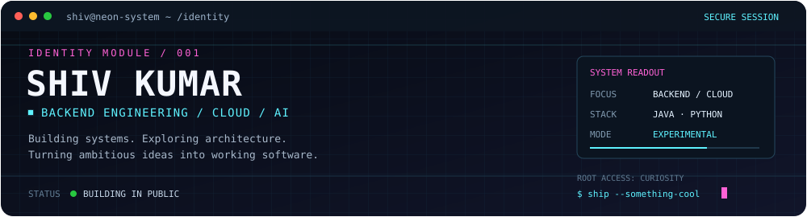
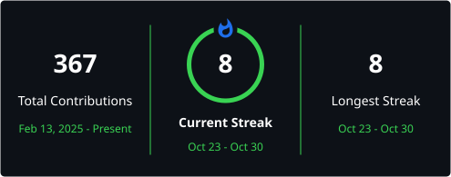

<p align="center">
  
</p>

<p align="center">
  <a href="https://shivkumar-pi.vercel.app/"><strong>PORTFOLIO</strong></a>
  &nbsp;·&nbsp;
  <a href="https://shadow-exchange-live.vercel.app/"><strong>SHADOW EXCHANGE LIVE</strong></a>
  &nbsp;·&nbsp;
  <a href="https://github.com/shivkumar077"><strong>GITHUB</strong></a>
  &nbsp;·&nbsp;
  <a href="https://www.linkedin.com/in/shiv-kumar-399a32231/"><strong>LINKEDIN</strong></a>
</p>

<p align="center">
  <code>BACKEND ENGINEERING</code> <code>CLOUD COMPUTING</code> <code>AI / ML</code> <code>SYSTEM DESIGN</code>
</p>

---

## `$ neofetch --profile`

```text
┌─ SYSTEM INFORMATION ──────────────────────────────────────────┐
│ User       : shivkumar077                                     │
│ Role       : B.Tech CSE — Cloud Computing                     │
│ Focus      : Backend engineering, cloud systems, AI/ML        │
│ Currently  : Building projects and sharpening core CS skills  │
│ IDEs       : VS Code, IntelliJ IDEA                           │
└───────────────────────────────────────────────────────────────┘
```

I'm a computer science student interested in the engineering behind reliable software: backend services, APIs, cloud infrastructure, and AI-powered systems. I like projects that force me to think beyond the happy path and understand how the pieces fit together.

## Featured Projects

| Project | Description | Links |
|---|---|---|
| **StreetChat** | Featured project. | Add project description/link |
| **Shadow Exchange** | A simulated stock exchange exploring backend architecture and trading-system concepts. | [Live demo](https://shadow-exchange-live.vercel.app/) · [Repository](https://github.com/shivkumar077/Shadow-Exchange) |
| **ASTRA** | A software project and space for ambitious technical experiments. | [Repository](https://github.com/shivkumar077/Astra) |
| **Developer Portfolio** | A personal home for my work, projects, and engineering journey. | [Visit portfolio](https://shivkumar-pi.vercel.app/) |
| **ECHO** | A world-simulation concept exploring how a living virtual environment might evolve. | [Repository](https://github.com/shivkumar077/ECHO) |

## `$ stack --current`

<p>
  
</p>

```text
LANGUAGES       Java · Python · JavaScript · TypeScript · SQL
BACKEND         Spring Boot · REST APIs · PostgreSQL · MySQL
TOOLS           Git · GitHub · VS Code · IntelliJ IDEA
EXPLORING       Cloud engineering · AI / ML · System design
```

## `$ github --telemetry`

<p>
  
  
</p>

<p align="center">
  
</p>

## `$ activity --visualize`

<p align="center">
  <picture>
    <source media="(prefers-color-scheme: dark)" srcset="./dist/github-contribution-grid-snake-dark.svg" />
    <source media="(prefers-color-scheme: light)" srcset="./dist/github-contribution-grid-snake.svg" />
    
  </picture>
</p>

<sub>Contribution visuals are generated automatically by GitHub Actions.</sub>

## `$ connect --with shiv`

- **Email:** [shivkumar6990655@gmail.com](mailto:shivkumar6990655@gmail.com)
- **LinkedIn:** [linkedin.com/in/shiv-kumar-399a32231](https://www.linkedin.com/in/shiv-kumar-399a32231/)
- **Instagram:** [@nightcore_077](https://www.instagram.com/nightcore_077/)
- **X:** [@nightcore_077](https://x.com/nightcore_077/)
- **Portfolio:** [shivkumar-pi.vercel.app](https://shivkumar-pi.vercel.app/)

---

<details>
  <summary><code>sudo reveal --classified</code> &nbsp; <sub>you found the hidden room</sub></summary>

  ```text
  ACCESS GRANTED // OPERATOR: CURIOUS HUMAN

  The best projects start with:
  "Wait... what if we tried something ridiculous?"

  Current prime directive:
  Learn deeply. Build boldly. Stay kind.
  Keep the weird ideas. Delete the pointless complexity.

  Thanks for exploring the terminal.
  You have excellent side-quest instincts.
  ```

  <p><a href="https://shivkumar-pi.vercel.app/">↗ Return to the mainframe</a></p>
</details>

<p align="center">
  <sub>Built with curiosity, terminal aesthetics, and a healthy amount of late-night debugging.</sub>
</p>
