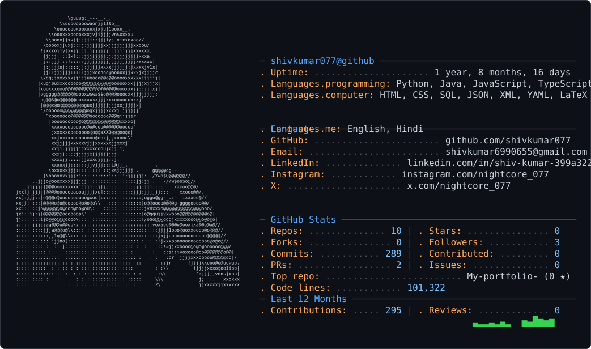

<picture>
  <source media="(prefers-color-scheme: dark)" srcset="dark_mode.svg" />
  <source media="(prefers-color-scheme: light)" srcset="light_mode.svg" />
  
</picture>

<div align="center">

# `shivkumar077@github`

**Computer Science Student · Backend Developer · Cloud & AI Enthusiast**

[Portfolio](https://shivkumar-pi.vercel.app/) · [GitHub](https://github.com/shivkumar077) · [Shadow Exchange Live](https://shadow-exchange-live.vercel.app/)

</div>

---

## `$ neofetch --profile`

```text
┌─ SYSTEM INFORMATION ──────────────────────────────────────────┐
│ User       : shivkumar077                                      │
│ Role       : B.Tech CSE — Cloud Computing                      │
│ Focus      : Backend engineering, cloud systems, AI/ML         │
│ Currently  : Building projects and sharpening core CS skills   │
│ IDEs       : VS Code, IntelliJ IDEA                             │
└───────────────────────────────────────────────────────────────┘
```

## `$ languages --list`

```text
PROGRAMMING
  Java          ██████████  Backend development / Spring Boot
  Python        ██████████  Scripting / AI & ML learning
  SQL           ███████░░░  Relational databases
  JavaScript    ██████░░░░  Web development
  HTML / CSS    ██████░░░░  Web interfaces

TOOLS & TECHNOLOGIES
  Spring Boot · PostgreSQL · Git · GitHub · REST APIs
  Docker / Cloud technologies — learning and building
```

## `$ ls ~/projects --featured`

| Project | What it is | Links |
|---|---|---|
| **Shadow Exchange** | A simulated stock exchange focused on backend engineering and trading-system concepts. | [Live demo](https://shadow-exchange-live.vercel.app/) |
| **ASTRA** | An ongoing software project. | [GitHub repository](https://github.com/shivkumar077/Astra) |
| **Portfolio** | My personal developer portfolio. | [Visit site](https://shivkumar-pi.vercel.app/) |
| **ECHO** | An ambitious world-simulation project concept. | [GitHub repository](https://github.com/shivkumar077/ECHO) |

## `$ github --stats`

<p>
  
  
</p>

<p>
  
</p>

## `$ connect --with shivkumar077`

- **Portfolio:** https://shivkumar-pi.vercel.app/
- **GitHub:** https://github.com/shivkumar077
- **LinkedIn:** Find me via my portfolio.

---

<sub>Built with curiosity, late-night debugging, and a terminal-inspired aesthetic.</sub>
